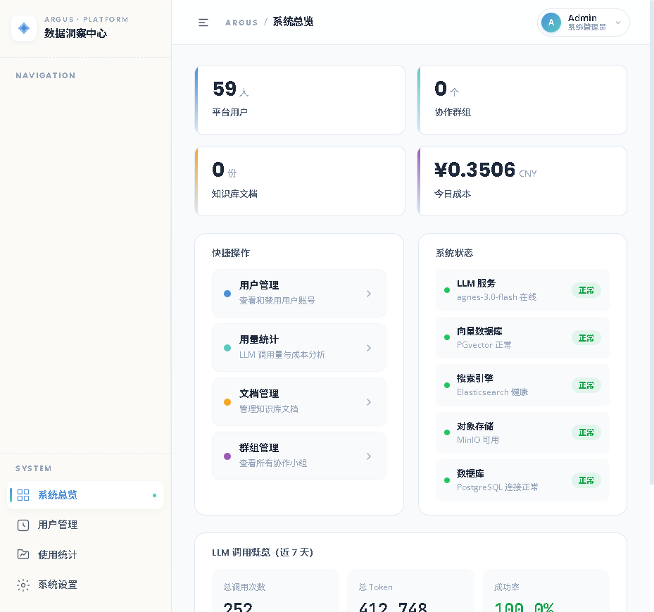
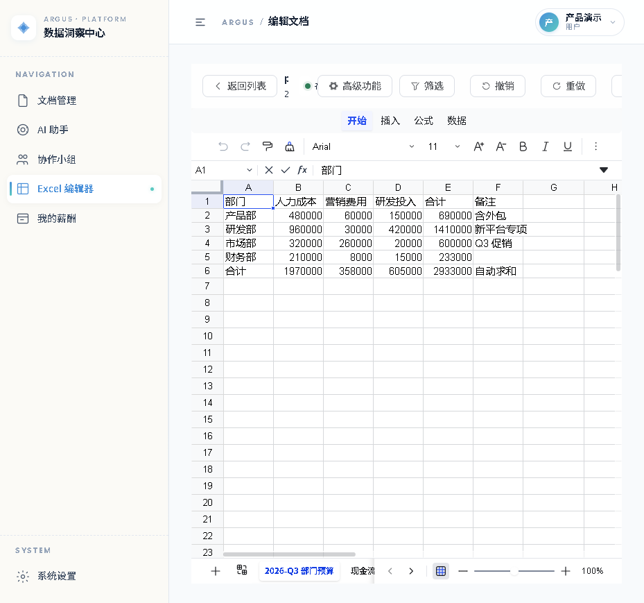
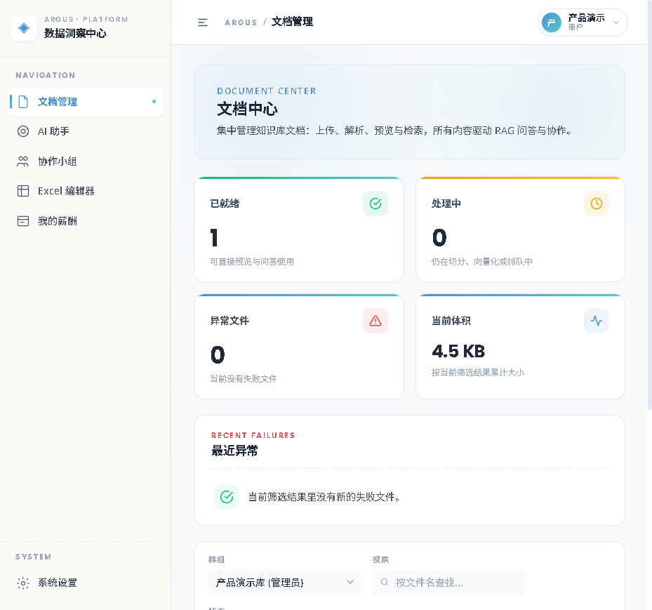
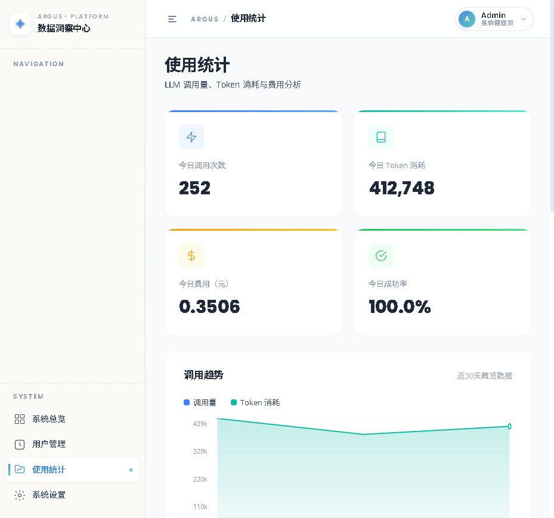
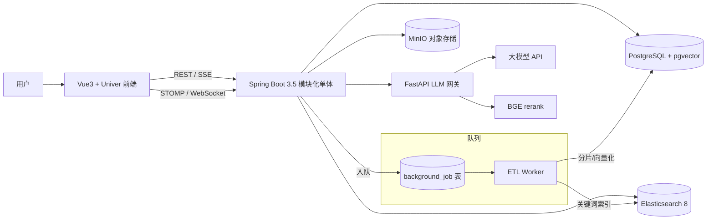

# Argus Loom — 企业级 RAG 知识库 + 在线 Excel 协同

面向约 500 名内部用户的企业知识库问答与财务 Excel 协作平台。模块化单体，一人可独立交付、可现场演示。**重点不是演示效果，而是权限可信、任务可恢复、回答有依据、协作可追踪。**

## 界面速览

| 系统总览（全组件健康检查 + LLM 成本观测） | Excel 在线协同编辑（Univer，双 Sheet 实时同步） |
| --- | --- |
|  |  |

| 文档中心（上传 → 异步解析 → 就绪可问答） | 使用统计（调用量 / Token / 成功率 / 费用趋势） |
| --- | --- |
|  |  |

## 核心亮点

| 能力 | 实现与量化 |
| --- | --- |
| 混合检索 RAG | 查询规划（直接/改写/拆解/全局）→ pgvector + ES 双路召回各 topK50 → RRF 融合 → BGE cross-encoder 精排（50 对 3.47s）→ 邻居窗口 ±1 → topK5 → 证据不足拒答 → 引用溯源 → SSE 流式 |
| 评测驱动 | 40 例基线集准确率 **95%**、拒答 **100%**；170 例压力集 NoOp 基线 HitRate@5 **97.6%**、综合 **94.1%**，评测带断点续跑可复现 |
| 可靠后台任务 | PostgreSQL `background_job` 队列：`FOR UPDATE SKIP LOCKED` 抢占、5 分钟租约、执行层故障退避重试后死信、同键复活、幂等三重保障（先清后建 + 确定性 UUID + 幂等键） |
| 在线 Excel 协同 | Vue3 + Univer，chunk+delta 存储模型，LWW 冲突合并，STOMP 实时同步 + PostgreSQL Outbox |
| 三层权限 fail-closed | 文档角色门禁 / Excel ACL / 财务角色独立校验；越权检索返回空证据而非 403（防枚举探测） |
| 工程质量 | **1649** 后端测试全绿 + 14 前端测试；生产配置缺失启动即 fail-fast（EnvironmentPostProcessor） |
| LLM 网关 | FastAPI 独立服务：OpenAI 兼容 chat 代理 + SSE 流式 + BGE rerank 端点，密钥仅从环境变量读取、缺失即拒绝启动 |

## 架构总览



三条核心链路的逐步时序图见 [`docs/核心链路时序图.md`](docs/核心链路时序图.md)。

## 技术选型 FAQ

**为什么任务队列用 PostgreSQL 而不是 RabbitMQ/Redis？**
当前量级（日均数百任务）下，引入 MQ 的运维成本大于收益；任务与业务数据同库，队列行和文档行**同事务提交**，天然消除"业务成功但消息丢失"的一致性窗口。队列深度有监控指标，规模上来再迁移是平滑的。

**为什么是模块化单体而不是微服务？**
单人交付 + 内部系统规模，单体把一致性、事务和部署复杂度都降到最低；模块边界（controller/service/mapper 分包 + 权限门禁）保证日后可拆。

**为什么 SSE 而不是 WebSocket 做流式问答？**
问答流是单向服务器→客户端，SSE 更轻且自动重连；WebSocket 留给真正双向的表格协同。

**Redis 在哪里？**
没有引入真实 Redis。`RedisChunkCacheService` 实为进程内有界 LRU+TTL 缓存——诚实的命名和诚实的架构比堆中间件更重要。

## 快速开始

依赖：JDK 21、PostgreSQL（含 pgvector）、Elasticsearch 8、MinIO。完整步骤见 [`docs/tutorials/12-从零启动指南.md`](docs/tutorials/12-从零启动指南.md)。

```powershell
.\scripts\start-all.ps1
# 前端 http://localhost:8081   后端 http://localhost:10001
```

## 文档导航

- 当前实现事实：`ai-handoff/PROJECT_TRUTH.md`（与代码、测试同步维护）
- 包结构与请求流：`ai-handoff/ARCHITECTURE.md`
- 本地开发与测试：`ai-handoff/DEVELOPMENT_GUIDE.md`
- 15 篇新手教程：`docs/tutorials/`（从 00-学习路线图 开始）
- 核心链路时序图：`docs/核心链路时序图.md`

## AI 协作开发方式

本项目由 Claude Code 深度参与完成，配套四层人工防护：任务上下文写死工程红线（不改已执行的迁移、权限 fail-closed）→ AI 产出必须先说明调用链/事务边界/失败路径 → 测试先行（失败测试→实现→全量回归）→ 人工安全审查（项目中两个 IDOR 越权漏洞即由人工审查发现并以 TDD 修复）。

## 验证状态

2026-10-24 本机验证：后端 `1649` tests / 0 failures / 0 errors（2026-10-25 复验）；前端 14 tests；前端 14 tests 全部通过；前端生产构建成功。

## 安全

不要提交 `.env`、真实密码、Token、上传文件、日志或财务数据。生产密钥必须来自环境变量；若默认凭据进入 Git 历史，应立即轮换。
