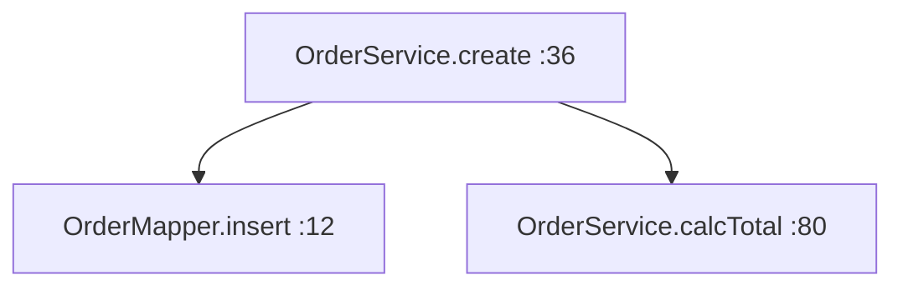

# 方法调用关系流程图 · 总入口

> 这份文档是 **Argus-Loom 后端源码的「方法级调用地图」** —— 把每个核心业务方法
> 调用了哪些其它方法、一路下钻到哪，用一张张 Mermaid 图画出来。
> **纯静态分析生成，不改任何代码。**

---

## 一、怎么读这些图

每张图对应 **「一个入口方法从哪开始调用了什么」**：



- **节点** `OrderService.create :36` = 「类名.方法名」+ 该方法在源码里所在的**行号**。
- **箭头** `m1 --> m2` = `create` 方法内部**调用了** `insert` / `calcTotal`。
- 读法：**跟箭头往下走**，就是程序真正执行的先后顺序。

### 省略规则（为了让图清爽，我刻意不画的东西）
- **getter / setter / 简单取值**（`getName()`、`getList()` 这种）：太碎，会淹没重点，已省略。
- **一行便利方法**（如 `this.x = y` 之类赋值）：不构成"调用关系"，不画。
- **跨库回调 / 反射调用**（只看代码静态看不出来的）：静态分析看不见，天然不在图里。

### 图里的社区
- 一张模块目录下有**两类文件**：
  - `00_类级总览.md` —— 该模块 **Class → Class** 的依赖地图（谁持有了谁），不看方法名。
  - `XxxController.xxx.md` / `XxxService.xxx.md` —— **某个具体方法**的完整调用链图。

---

## 二、各模块图索引（建议从这 6 条主链路入手）

| 想搞懂 | 去哪个文件 |
|---|---|
| 用户**登录**（JWT＋刷新令牌，全流程） | `auth/AuthController.login.md` |
| 用户**发一条 RAG 问答**（先检索再调大模型） | `qa/QaController.askQuestion.md` |
| 用户**上传并切分一个文档** | `document/DocumentController.uploadDocument.md` |
| **在线 Excel**：打开一个文档加载全部单元格 | `excel/ExcelDocumentController.loadAllCelldata.md` |
| **财务导入**（工资表导入并汇总） | `finance/FinanceReportController.upsertPayroll.md` |
| AI 助手**多轮对话流式返回** | `assistant/AssistantChatController.streamChat.md` |

> 各模块也都有一个你一眼能点的入口：`<模块>/00_类级总览.md`。

---

## 三、怎么「重新生成」这份地图

这份图是脚本生成的，源码变了想刷新，跑一次即可（本机用真解释器 `python`）：

```bash
cd docs/callgraph
python gen_all.py            # 重新生成全部模块
python gen_all.py auth qa   # 只重新生成指定模块
```

脚本本身是两个小工具：
- `docs/callgraph/modflow.py` —— 模块级「类→类」依赖图。
- `docs/callgraph/callflow.py` —— 方法级调用链 BFS（真正干活的主体）。
- `docs/callgraph/gen_all.py` —— 帮你批量把每个类的每个方法都生成一张图。

---

## 四、已知限制（别被误导）

1. **只看"调用谁"，不讲"为什么"**——这是结构图，不是教学笔记；要"为什么"请看 `docs/核心链路-陪读-…md`。
2. **接口 vs 实现**：调的是接口方法时，节点可能是接口或第一个实现类；跨实现可能不完全体现在一张图里。
3. **反射 / 动态代理（如 MyBatis-Plus Mapper、Spring AOP、Redis）** 静态分析捕捉不到，这类方法是**隐边界**，图里常止步于"调用 Mapper"那一层。
4. **行号 = 方法签名所在行**，指向源码方便你 `Ctrl+点击` 跳转核对。

---

_生成于 2026-09-21 · 后端 11 个模块、173 张方法级调用图。_