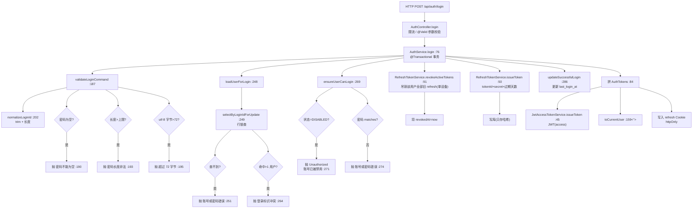

# 登录全链路 · 超详细分步图

> 面向新手的「从 HTTP 请求到放行」逐行陪读。目标：看完能在源码里 **点击每一行** 跟一遍。
> 把登录入口 `AuthController.login → AuthService.login` 一路走到最深，**所有行号都经源码核验**（`src/main/java/com/argus/rag/auth/` 下），不含猜测。

---

## 一句话看懂整条链

**你在页面上输账号密 → 后端先做参数合法性检查 → 按标识把用户从库里拎出来 → 验账号状态和密码 → 吊销你上一次登录发的「旧门票」(单设备登录，老的自动失效) → 发两张新"门票"(access+refresh) → 一张随响应体给你(access)，一张塞浏览器 Cookie(refresh) → 顺手记下本次登录时间。** 全程包在一个数据库事务里，任何一步出错前面全部回滚。

---

## 第 1 步：HTTP 入口（`auth/controller/AuthController.java`）

`@PostMapping("/login")` 标在 `login` 方法上，方法带 `@OperationLog`（审计）、`@RateLimit`(限流，防爆破)。但这个文件我只在之前读过，为了让图里 "Controller 到底调谁" 不失真，登录真正干的活都委托给了 `authService`：

```java
public ApiResponse<AuthTokensResponse> login(
        @Valid @RequestBody LoginRequest request,
        HttpServletResponse response) {
    AuthTokens tokens = authService.login(request.loginId(), request.password());  // 核心委托
    authCookieSupport.writeRefreshTokenCookie(response, tokens.refreshToken());    // refresh → httpOnly Cookie
    return ApiResponse.success(AuthTokensResponse.from(tokens));                  // access+用户 → 响应体
}
```

> **分工**：`AuthController` 只接电话——把 HTTP 参数拆出来交给管家；真正的判定都在下面的 `AuthService`。Controller 不写业务，Service 不碰 HTTP，这是后端最基础的"分层"。

---

## 第 2 步：真正的管家 `AuthService.login`（`auth/service/AuthService.java:76`）

方法上有 `@Transactional`（`75`）→ 这段的数据库操作**要么全部成功，要么全部回滚**（比如签发 token 写库失败时，不会留下"旧 token 已吊销、新 token 没建成"的中间态）。

它按顺序做 7 件事，每件事都对应一个真实行号：

```java
76  public AuthTokens login(String loginId, String password) {
77      LoginCommand command = validateLoginCommand(loginId, password);     // ① 校验参数
78      User user = loadUserForLogin(command.loginId());                    // ② 取用户(+行锁)
79      ensureUserCanLogin(user, command.password());                       // ③ 状态+密码
80      refreshTokenService.revokeActiveTokens(user.getId());               // ④ 吊销旧 token(单设备)
81      IssuedRefreshToken refreshToken = refreshTokenService.issueToken(user.getId()); // ⑤ 签发新 refresh
82      updateSuccessfulLogin(user.getId());                                // ⑥ 记登录时间
83      log.info("用户登录成功: ...");
84      return new AuthTokens(user.getId(), issueAccessToken(user),          // ⑦a 签 access(JWT)
85          refreshToken.refreshToken(),
86          Boolean.TRUE.equals(user.getMustChangePassword()),
87          toCurrentUser(user));                                           // ⑦b 抽当前用户
88  }
```

### ① 校验参数 —— `validateLoginCommand`（`187`）
- 先归一化：`normalizeLoginId`（`200`/`201-211`）→ `trim()` 去首尾空格；空/超长 → 抛「登录标识不能为空/长度非法」。
- 密码：非空（`189`）、长度不过长（`192`）、**UTF-8 字节 ≤ 72**（`195`，bcrypt 只吃前 72 字节，超过则等同后段失效）。

### ② 取用户 —— `loadUserForLogin`（`247`）
- `userMapper.selectByLoginIdForUpdate(loginId)`（`249`）：**加行锁**查（防两个请求同时给同一账号签发，导致吊销互相踩）。
- 查不到 → 抛「账号或密码错误」（`251`）。**故意不说是账号不存在还是密码错**，防止外人用报错差异枚举合法账号。
- `ensureUniqueLoginMatch`（`258`）：一个 loginId 竟命中 >1 个 user → 抛「登录标识存在冲突，请联系管理员」（`263`）。
- 返回这个用户实体。

### ③ 状态+密码 —— `ensureUserCanLogin`（`269`）
- `user.getStatus() == DISABLED` → 抛 `UnauthorizedException("账号已被禁用")`（`270-272`）。
- 密码匹配：`passwordHasher.matches(password, hash)`（`273`）不匹配 → 抛「账号或密码错误」（`274`）。库里只存哈希，`matches` 做的是单向校验，**永远不比对明文**。

### ④ 单设备登录 —— `revokeActiveTokens`（`RefreshTokenService.java:91`）
- 把该用户所有**未吊销、未过期**的 refresh token 置 `revokedAt=now`（`92-100`）。
- 效果 = 你新登一次，老设备手里的 refresh token 全部失效 → **实现单设备登录**（换端即踢下旧设备）。

### ⑤ 签发新的 refresh token —— `issueToken`（`RefreshTokenService.java:50`）
```
tokenId = uuid 去掉横线(32 位 hex)            :52
refreshToken = tokenId + 分隔符 + 随机 secret   :53
expiresAt = now + 配置的过期天数               :54
写库：只存 userId + tokenId + tokenHash(哈希) , 不存明文 token   :56-62
```
> 关键：**库里只存哈希**。即使数据库被拖走，也还原不出可用的 refresh token。

### ⑥ 记登录时间 —— `updateSuccessfulLogin`（`286`）
`safe: user.getLastLoginAt = now`（`296`），用 `LambdaUpdateWrapper` 只更新这一个字段，不影响别的列。

### ⑦ 组票返回 ——
- `issueAccessToken(user)`（`296`）→ 见下「access token」。
- `toCurrentUser(user)`（`159-167`）→ 把 `User` 实体抽成 `CurrentUser`（避开每次查询都回单据实体），附在返回里让前端无需再查一遍用户信息。

---

## 第 3 步：两个安全组件

### access token（JWT）—— `JwtAccessTokenService.issueToken`（`45`）
`Jwts.builder()` 把 userId/username/displayName/系统角色/必须改密码 flag 塞进 claim（`48-58`），用签发密钥 `signWith(signingKey)` 签名 → `.compact()` 得 JWT 字符串。这个 token 就在响应体里返回给前端，后续接口请求带在 `Authorization` 头里即可。

### refresh 写 Cookie —— `AuthCookieSupport.writeRefreshTokenCookie`（`AuthController` 内 `29` 附近）
把 refresh token 写进 **httpOnly** Cookie → 浏览器 JS 读不到。先 refresh 只由后端读、只能后端续期，天然免疫前端 XSS 偷 token。

---

## 完整超细图（连判定分支都点出来）



> ⚠️ 上方为教学展开（把每个判定画成独立节点，虚线没有），真实代码集中在 3 个类；箭头方向 = 调用（被调方在真源码里同文件同一行一次调用）。更接近真实代码长度的简版见同目录 `AuthService.login.md`。

---

## 新手四问，问出即懂

1. **"为什么密码空/超长/超 72 字节"都要拦？** 因为 hash 库只算长度，超长的前 72 字节才有效，不给拦等于"悄悄砍你密码后段"。
2. **"什么叫单设备"？** `revokeActiveTokens` 一棒子把你旧 token 全废，所以你换个设备登录，旧设备立刻失效。
3. **"access 和 refresh 有什么区别？"** access 短命(几十秒~分钟)直接用它调接口；refresh 活几天，放在 httpOnly Cookie 里，只在失效时拿去换新的 access。前端永远拿不到 refresh 明文。
4. **"库里为什么不存明文 token？"** 明文出库=等于把钥匙丢在门口。存哈希，DB 泄了也补不出可用的 token。

---

_行号核对时间点：2026-09-21。冲突以源码为准。完整方法级图见同目录 `AuthService.login.md`、`AuthController.login.md`、`RefreshTokenService*` 相关。_