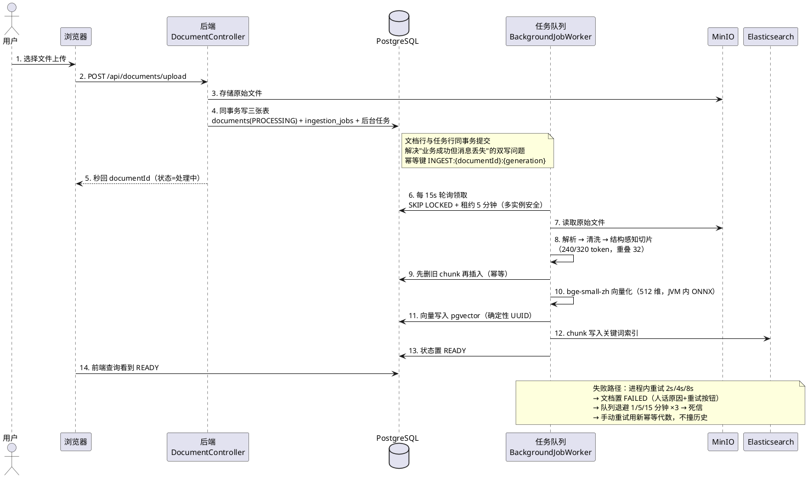
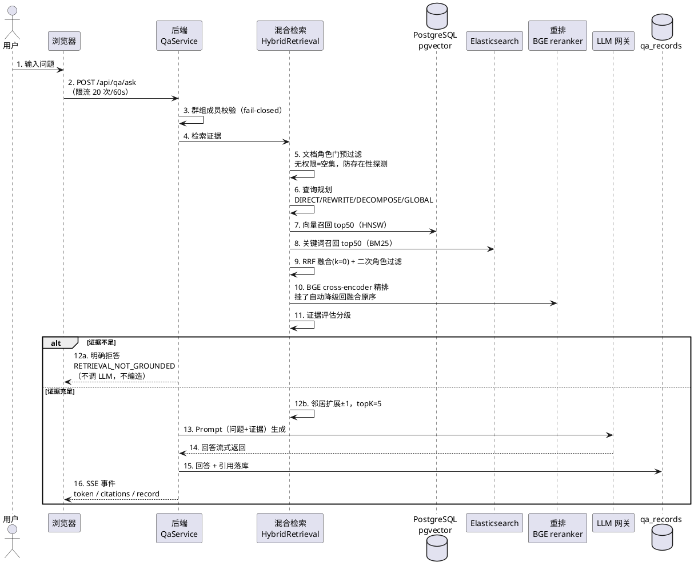
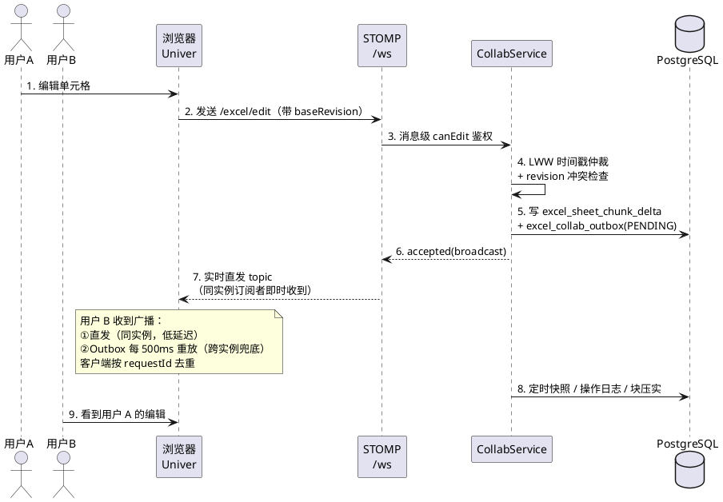

# Argus-Loom 核心链路调用图（时序图版）

> 三条核心链路的泳道时序图，可直接粘到语雀（代码块语言选 PlantUML 即可渲染）。
> 内容与代码一致（2026-10-24 核实），配合 `backend/docs/流程架构图/` 与方法级调用图食用。

## 图 1 · 文档上传与 ETL 入库（背景任务队列）

## 图 2 · RAG 问答（检索 → 证据 → 生成 → 引用）

## 图 3 · 在线 Excel 协同编辑（LWW + Outbox）

## 附：怎么背这张图（面试用法）

- 图 1 对应逐字稿第 6 题（ETL 失败处理）与题库 Q13（为什么用数据库队列）。
- 图 2 对应逐字稿第 3/4/5 题（双路召回、精排降级、防幻觉）。
- 图 3 对应题库 Excel 协同追问（LWW/冲突/去重）。
- 面试白板时按"泳道 → 编号步骤 → 注释"的顺序画，每条注释都是一句设计取舍。
