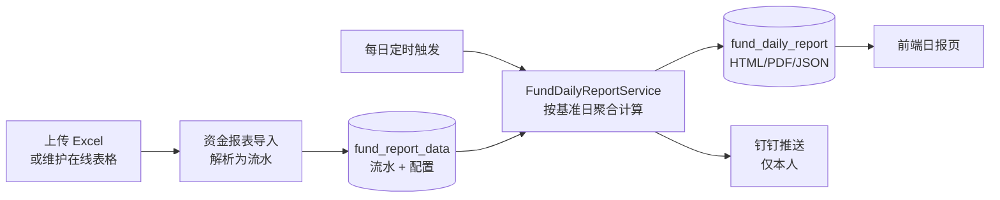

# 资金日报功能设计（个人版）

> 状态：设计稿
> 日期：2026-11-07
> 来源：将 `fund-daily-report` WorkBuddy 技能的能力并入 argus-loom

> **实施状态（2026-11-07）**：阶段 1 完成（上传 → 解析计算 → 日报落库 → 前端看板 →
> 钉钉推送与定时调度就绪待凭据）。解析口径经样例金标准比对与 Python 生成器完全一致，
> 详见 `docs/通用日报引擎设计.md` 的实施状态。

## 1. 背景与目标

在 argus-loom 财务模块下新增「资金日报」功能，个人使用：

1. **数据入口**：上传资金报表 Excel（.xlsx/.xls，每文件=一公司，每 Sheet=一账户），
   后续支持维护在线 Excel（Univer 协同表）作为数据源；
2. **计算**：按配置规则读取数据——公司名解析、借贷方向、转账关键字剔除、
   理财桶、币种汇率折算——算出各账户与全集团的上日余额/收入/支出/结余；
3. **日报**：生成 HTML/PDF 看板 + 结构化 JSON；
4. **推送**：每天定时把日报**只发送给用户本人**（钉钉）。

不做：多公司权限体系、共享目录扫描、企业级死信告警体系。复用主项目已有机制，
但不为个人功能加不需要的企业级复杂度。

## 2. 数据流



## 3. 复用与新增

| 能力 | 方案 |
| --- | --- |
| Excel 解析 | 新增 `FundReportWorkbookParser`（POI，参照 `FinanceWorkbookExtractor` 模式），规则全部来自配置（JSONB），不写死公司信息 |
| 定时调度 | Spring `@Scheduled` 每日触发，直接同步执行（个人量级无需 background_job 队列；生成耗时秒级） |
| PDF 生成 | HTML → PDF，参照 `FinanceReportPdfService` 现有模式 |
| 钉钉推送 | 后端 RestClient 调钉钉，**凭据走环境变量，缺失则跳过推送只落库**（fail-open，不阻塞生成） |
| 前端 | 财务模块下新增「资金日报」页：当日卡片 + 账户明细 + 历史列表 + 手动生成按钮 |

## 4. 数据模型（Flyway V9）

```sql
-- 日报主表：一个基准日一行，重跑覆盖
CREATE TABLE IF NOT EXISTS fund_daily_report (
    id BIGSERIAL PRIMARY KEY,
    report_date DATE NOT NULL UNIQUE,
    owner_user_id BIGINT NOT NULL,                     -- 推送目标（本人）
    total_income NUMERIC(20,2),
    total_payout NUMERIC(20,2),
    total_balance NUMERIC(20,2),
    report_html TEXT,                                  -- 直接存库（个人量级，MinIO 可后续再加）
    report_json TEXT,                                  -- 前端看板数据源
    push_status VARCHAR(16) NOT NULL DEFAULT 'PENDING',-- PENDING/SKIPPED/SENT/FAILED
    push_message VARCHAR(256),
    created_at TIMESTAMP NOT NULL DEFAULT CURRENT_TIMESTAMP,
    updated_at TIMESTAMP
);

-- 业务规则配置（沿用技能 user.json 结构），单用户一行
CREATE TABLE IF NOT EXISTS fund_report_config (
    id BIGSERIAL PRIMARY KEY,
    owner_user_id BIGINT NOT NULL UNIQUE,
    config_json JSONB NOT NULL,       -- 公司名解析/借贷方向/转账关键字/币种/汇率
    updated_at TIMESTAMP NOT NULL DEFAULT CURRENT_TIMESTAMP
);
```

导入明细暂不入库：解析是生成时的瞬时操作（上传后缓存解析结果 JSON，
按文件哈希幂等），避免维护一张和 `finance_ledger_record` 平行的流水表。
数据源文件原件存 MinIO（现有上传链路），可回溯。

## 5. 计算逻辑移植

从 `fund-daily-report/scripts/gen_fund_daily.py` 移植，口径以技能为基准：

1. **基准日**：严格取当天（T0），不回退；当天无流水则收入/支出记 0，
   余额/结余取上期结转；
2. **净额口径**：账户级 income/payout 为净额——内部转账与理财各自成桶，
   看板以「转/财」角标 + 剔除行展示；
3. **理财桶**：借方（定赎/到期，资金回活期）→ `finance_payout`，
   贷方（买入理财）→ `finance_income`——与技能 2026-09-23 修复后的口径一致；
4. **外币**：按报告月汇率折算并入合计；结转账户按上期月汇率；
5. **自校验**：生成时按资金合计 =「人民币 + 全部外币折算」做一次合计复核，
   不一致则日报标 FAILED 并在页面上显示，不推送。

## 6. 接口设计

| 方法 | 路径 | 说明 |
| --- | --- | --- |
| POST | `/api/finance/fund-daily/upload` | 上传报表 Excel（multipart） |
| GET | `/api/finance/fund-daily?date=` | 单日日报 JSON |
| GET | `/api/finance/fund-daily/list?from=&to=` | 历史列表 |
| POST | `/api/finance/fund-daily/generate?date=` | 手动生成/重跑 |
| GET/PUT | `/api/finance/fund-daily/config` | 规则配置 |

权限：登录用户只能读写自己（owner_user_id）的数据；挂在 finance 路径下沿用
现有鉴权风格。

## 7. 钉钉推送（只发本人）

用户将重新授权。预留两种接入方式，凭据均走环境变量（缺失即 SKIPPED 不报错）：

| 方式 | 所需凭据 | 适用 |
| --- | --- | --- |
| 自定义机器人 webhook | `FUND_DD_WEBHOOK`（+可选加签 secret） | 最简单：建一个只有自己的群，加机器人 |
| 企业内部应用工作通知 | `FUND_DD_APP_KEY` / `FUND_DD_APP_SECRET` / userid | 正式一点：应用消息直达本人 |

待用户提供凭据后选定实现（优先 webhook，代码量最小）。

## 8. 实施顺序

1. **阶段 1（核心闭环）**：V9 建表 → 上传 + 解析 → 生成 JSON/HTML/PDF → 前端页面；
   钉钉先留桩（push_status=SKIPPED）。
2. **阶段 2**：定时触发 + 钉钉推送（凭据到位后接）。
3. **阶段 3（可选）**：在线 Excel（Univer）作为数据源——从协同快照读取数据，
   替代/补充文件上传。

用真实报表做验收：生成结果与 WorkBuddy 现有产物对比一致后切换。
